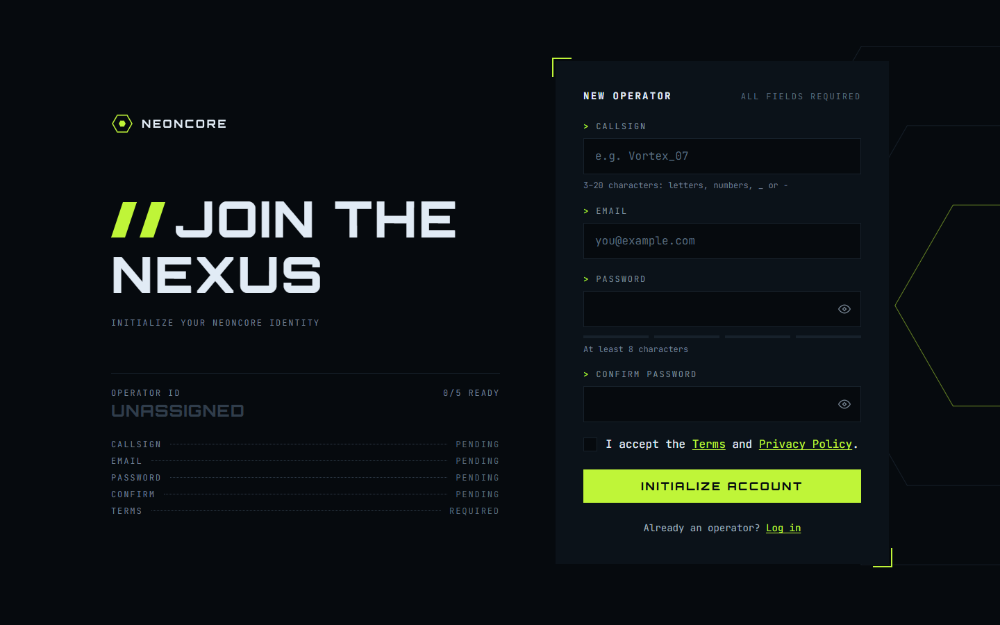
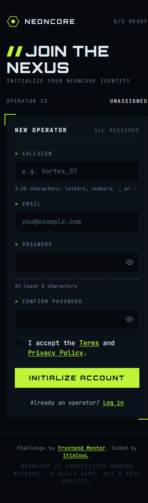

# Frontend Mentor - Gamer sign-up form solution

This is a solution to the [Gamer sign-up form challenge on Frontend Mentor](https://www.frontendmentor.io/challenges). Frontend Mentor challenges help you improve your coding skills by building realistic projects.

## Table of contents

- [Overview](#overview)
  - [The challenge](#the-challenge)
  - [Screenshot](#screenshot)
  - [Links](#links)
- [My process](#my-process)
  - [Built with](#built-with)
  - [What I learned](#what-i-learned)
  - [Continued development](#continued-development)
  - [Useful resources](#useful-resources)
- [Development](#development)
- [Author](#author)

## Overview

### The challenge

Build the sign-up form for **NEONCORE**, a competitive-gaming network. Most of the work is in the form's states.

Users should be able to:

- Fill in a callsign, email, password, and password confirmation, and accept the terms
- Receive validation messages when:
  - any field is missed
  - the callsign is shorter than 3 characters, longer than 20, or uses anything other than letters, numbers, `_` or `-`
  - the email isn't formatted correctly
  - the password is shorter than 8 characters
  - the passwords don't match
  - the terms checkbox isn't ticked
- Show and hide each password with the eye button
- See a password **strength meter** update as they type
- See a **loading** state on the button while the form submits, then a **success** message
- Complete the whole form using only the keyboard, with inputs, hints, errors, and the success message announced on a screen reader
- View the optimal layout for their device's screen size and see hover/focus states for every interactive element
- **Optional extra:** the Operator ID readout beside the form mirrors the form in real time

### Screenshot

| Desktop                              | Mobile                             |
| ------------------------------------ | ---------------------------------- |
|  |  |

### Links

- Solution URL: [Vercel](https://gamer-sign-up-form-main.vercel.app/)
- Live Site URL: [mmalabugin.ru/GamerSignUpForm](https://mmalabugin.ru/GamerSignUpForm/)

## My process

### Built with

- **[SvelteKit 3](https://svelte.dev/docs/kit) + [Svelte 5](https://svelte.dev/docs/svelte) (runes) + Vite 8 + TypeScript** — this challenge's "new framework". Configuration lives entirely in `vite.config.ts` (SvelteKit 3 dropped `svelte.config.js`), and the site is fully **prerendered to static HTML** with `@sveltejs/adapter-static`, so there is no server at runtime.
- **`@sveltejs/adapter-static`** → a single `index.html` + hashed assets in `dist/`, with relative asset paths so the same build serves both the Vercel root and the sub-path deploy.
- Reactive state as a **runes class** (`SignupForm` in a `.svelte.ts` module): `$state` for field values and the lifecycle, `$derived` for the error map, password strength, ready-count, and per-row Operator-ID status. One shared instance feeds both the form panel and the readout.
- **Pure, unit-tested logic** — `validateCallsign/Email/Password/Confirm/Terms` and `scorePassword` live in a framework-free `validation.ts` and are covered by Vitest.
- Semantic HTML with `aria-invalid`, `aria-describedby` wiring each hint/error to its field, and a single `aria-live="assertive"` region for the "N fields need attention" / submit / success announcements.
- CSS custom properties from the style guide, Flexbox + Grid, desktop-first media queries, a 4px spacing scale, and `border-radius: 0` everywhere.
- Self-hosted **Orbitron** + **JetBrains Mono** (`font-display: optional` + `<link rel="preload">`) to avoid font-swap layout shift.
- Motion-safe flourishes gated behind `@media (prefers-reduced-motion: no-preference)`: the invalid-submit panel shake and the success hex-check drawing itself in.

### What I learned

- **One data structure drives everything.** `validateX` returns `{ code, message } | null`. The `message` is shown under the field; the `code` is mapped to the Operator-ID fault label (`Too short`, `Malformed`, `Mismatch`, …). The readout, the red borders, and the inline messages all fall out of the same derived error map — no duplicated logic.
- **"Checked" vs "valid" are different things.** A field is only *checked* once it loses focus with content (or on submit); after that it re-validates on every keystroke. The green tick and the error both key off `checked && …`, while the `X/5 ready` counter keys off raw validity — which is why a lone valid password reads `1/5` before anything has been blurred.
- **Password strength is additive and capped.** From 8 characters, one point each for length ≥ 8, length ≥ 12, mixed case, a digit, and a symbol, capped at 4 → Weak / Fair / Good / Strong, with the meter coloured red → amber → lime.
- **Pixel-perfect vertical rhythm across states.** The trick that made the filled/error/success frames line up was realising the design centres the *row block* in the viewport (`align-content: center`) while top-aligning the columns (`align-items: start`), with the logo a constant 74px below the panel top. The success panel is pinned to the form panel's exact height so swapping views never shifts the layout.
- **SvelteKit 3 specifics.** `#lib` subpath imports don't resolve a `.svelte.ts` module, so the runes store is imported relatively; and Vitest needs a standalone config because the project `tsconfig` extends `$app/tsconfig` (generated by `svelte-kit sync`).

### Continued development

- A matching log-in form that reuses the field, button, and error styles.
- A Caps-Lock warning is wired up for the password fields; next is styling autofill, selection, and the scrollbar to match the dark theme.
- Replacing the `setTimeout` submit stub with a real endpoint and surfacing network errors in the same message slots.

### Useful resources

- [Svelte 5 runes](https://svelte.dev/docs/svelte/what-are-runes) — `$state` / `$derived` in a `.svelte.ts` class.
- [SvelteKit adapter-static](https://svelte.dev/docs/kit/adapter-static) — prerendering a no-backend SPA to plain HTML.
- [WAI-ARIA: describing form errors](https://www.w3.org/WAI/tutorials/forms/notifications/) — `aria-describedby` and live regions.

## Development

```bash
npm install
npm run dev      # http://localhost:5173
npm run test     # vitest (validation + password strength)
npm run check    # svelte-check
npm run build    # vite build → prerender → dist/
```

Deploy convention: `main` targets **Vercel** (the `paths.base` block in `vite.config.ts` stays commented, so the default relative paths serve from the root). The `deploy` branch uncomments `paths: { base: '/GamerSignUpForm', relative: false }` and is built by **Jenkins** into an nginx Docker image, deployed to **Kubernetes** behind the shared Traefik ingress (`ingresses` repo) at `mmalabugin.ru/GamerSignUpForm/`.

## Author

- Website - [mmalabugin.ru](https://mmalabugin.ru/)
- Frontend Mentor - [@1t1sCooL](https://www.frontendmentor.io/profile/1t1sCooL)
- Twitter - [@vi_el_mar](https://www.twitter.com/vi_el_mar)
- Telegram - [@ItIsCooL](https://t.me/ItIsCooL)
